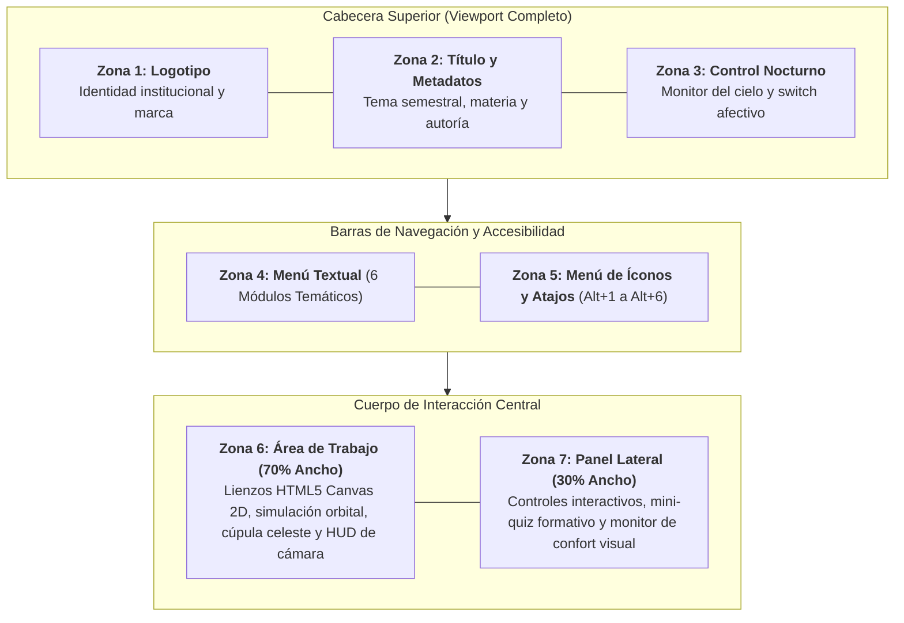

<div align="center">

# 🌌 AstroEdu — Plataforma Multimedia Interactiva de Astronomía

**Aplicación web educativa para el aprendizaje de la astronomía básica y la observación del cielo nocturno.**  
*Desarrollada bajo estándares de Interacción Humano-Computador (HCI), Zonificación de Pantalla en 7 Zonas e Interfaces Afectivas.*

[](https://astroedu-interfaces.vercel.app)
[](https://github.com/Klopezxd/astroedu-interfaces)
[](#-stack-tecnológico)
[](#-stack-tecnológico)
[](#-stack-tecnológico)
[](https://www.espe.edu.ec)

[🚀 **Explorar Aplicación en Vivo**](https://astroedu-interfaces.vercel.app) • [📂 **Ver Evidencias Digitales**](Lopez_Quilligana_Klever_IP/) • [📑 **Revisar Módulos**](#-módulos-educativos-interactivos)

</div>

---

## 🏛️ Ficha Técnica Institucional

| Parámetro | Detalle Institucional |
| :--- | :--- |
| **Institución:** | Universidad de las Fuerzas Armadas ESPE |
| **Departamento:** | Departamento de Ciencias de la Computación (DCC) |
| **Carrera:** | Ingeniería en Tecnologías de la Información |
| **Asignatura:** | Interfaces y Multimedia — **NRC: 36733** |
| **Período Académico:** | Primer Parcial (Período 202651) |
| **Docente Titular:** | Ing. Germán Ñacato Caiza |
| **Autor / Estudiante:** | **Klever Josué López Quilligana** |
| **Tema Aprobado:** | *Diseño y Desarrollo de una Aplicación Multimedia Educativa para Fortalecer el Aprendizaje de la Astronomía Básica y la Observación del Cielo Nocturno (AstroEdu)* |

---

## 📖 Visión General del Proyecto

**AstroEdu** es una plataforma web multimedia diseñada para transformar la enseñanza de la astronomía en una experiencia dinámica, accesible y formativa. En lugar de obligar al estudiante a memorizar distancias abstractas y fórmulas áridas, la aplicación permite **experimentar directamente con los fenómenos del cosmos**: manipular órbitas planetarias en tiempo real, deslizar el terminador de iluminación lunar, simular la caída de bólidos con síntesis acústica y calibrar parámetros fotográficos de exposición manual.

La arquitectura del sistema fue construida desde cero sin sobrecargas de librerías externas pesadas (cero dependencias de npm), garantizando una tasa de refresco constante de **60 cuadros por segundo**, carga instantánea y compatibilidad universal en computadoras, tabletas y dispositivos móviles.

---

## 📐 Arquitectura de la Interfaz: Zonificación Maestra de 7 Zonas

La pantalla se distribuye mediante una retícula formal dividida en **siete zonas funcionales** rigurosamente acopladas a los principios de jerarquía visual y economía cognitiva:



### Descripción Operativa de Zonas:
1. **Zona 1 (Logotipo Institucional):** Imagotipo vectorial SVG interactivo de AstroEdu integrado con la identidad de la ESPE.
2. **Zona 2 (Título del Proyecto):** Encabezado con tipografía clara que identifica el proyecto educativo, la asignatura y el estudiante responsable.
3. **Zona 3 (Banner y Control Afectivo):** Estado astronómico en vivo y conmutador maestro de **Modo Nocturno (Luz Roja Escotópica)**.
4. **Zona 4 (Menú Textual de Módulos):** Selector horizontal de acceso directo a los 6 temas de estudio.
5. **Zona 5 (Barra de Íconos y Atajos):** Botones gráficos con *tooltips* explicativos y atajos por teclado físico (`Alt + 1` al `Alt + 6`).
6. **Zona 6 (Área de Contenido / Trabajo):** Lienzo principal donde se ejecutan las simulaciones en HTML5 `<canvas>` a 60 fps.
7. **Zona 7 (Panel Lateral de Interacción):** Columna de mandos específicos, autoevaluación formativa con feedback inmediato y medidor de confort visual.
* **Pie de Página Institucional:** Franja inferior con metadatos de autoría, carrera y departamento.

---

## 🎨 Principios de Diseño Visual y Multimedia

### 1. Regla de los Tres Colores Armónicos (60-30-10)
* **Color Dominante (60%):** `#060b19` (Azul Noche Cósmico) — Proporciona un entorno oscuro que evoca el firmamento y descansa la vista.
* **Color Secundario (30%):** `#0f172a` / `#1e293b` (Gris Pizarra Espacial) — Delimita contenedores, tarjetas y paneles con orden y sobriedad.
* **Color de Acento (10%):** `#38bdf8` (Cian Celeste) y `#f59e0b` (Ámbar Cálido) — Destaca botones de acción, selecciones activas y estados críticos.

### 2. Figuras Retóricas Aplicadas a la Interfaz
* **Metáfora Visual:** La pantalla adopta la interfaz circular graduada de un *telescopio astronómico* con retícula de apuntado.
* **Metonimia:** Los anillos inclinados de Saturno representan visualmente a todo el módulo del Sistema Solar en la barra de navegación.
* **Hipérbole Pedagógica:** Aumento deliberado y proporcional del diámetro de los planetas respecto a sus órbitas para garantizar legibilidad didáctica.
* **Elipsis:** Supresión de galaxias o fondos recargados durante el estudio lunar para concentrar el 100% de la atención en el terminador de sombra.

---

## 🚀 Módulos Educativos Interactivos

```
┌─────────────────────────────────────────────────────────────────────────────────────────────────┐
│                                   ASTROEDU: 6 MÓDULOS EN VIVO                                   │
└─────────────────────────────────────────────────────────────────────────────────────────────────┘
  1. 🪐 Sistema Solar y Planetas  ──> Simulación orbital física con traslación elíptica y fichas.
  2. ✨ Constelaciones y Estrellas ─> Bóveda celeste con 200+ estrellas, coordenadas y líneas guía.
  3. 🌘 La Luna, Fases y Eclipses ──> Modelado del ciclo sinódico (0 a 29.5 d) y Luna de Sangre.
  4. ☄️ Lluvias de Meteoros        ──> Generador de bólidos con física cinemática y audio sintético.
  5. 🌌 Galaxias y Espacio Profundo > Galería fotográfica oficial Hubble & James Webb (JWST).
  6. 📸 Astrofotografía Móvil     ──> HUD manual de cámara (ISO, obturación, enfoque) y Escala Bortle.
```

### Detalle de Funcionalidades por Módulo:

| Módulo | Componentes de Interacción | Rigor Formativo & Científico |
| :--- | :--- | :--- |
| **1. El Sistema Solar** | Botones de pausa/marcha, multiplicador de velocidad ($1\times, 2\times, 4\times$) y selección de planeta por clic directo en órbita. | Distinción física entre planetas rocosos interiores y gigantes gaseosos exteriores; fichas con masa, gravedad y temperatura. |
| **2. Constelaciones** | Activación independiente de líneas de unión estelar, etiquetas de nombres y cuadrícula de coordenadas celestes. | Cartografía de constelaciones guía (*Orión*, *Osa Mayor*, *Cruz del Sur*) con cálculo de magnitud aparente visual. |
| **3. La Luna y sus Fases** | Control deslizante de ciclo de 0 a 29.5 días, visor de porcentaje de iluminación y simulador de eclipses lunares/solares. | Modelado del terminador lunar sobre Canvas y reproducción del tono cobrizo por dispersión Rayleigh en eclipse total. |
| **4. Meteoros y Cometas** | Botón para detonar bólidos brillantes y simulación continua de estrellas fugaces con audio posicional nativo. | Representación de las lluvias periódicas anuales (*Perseidas*, *Gemínidas*) y física de desintegración atmosférica. |
| **5. Espacio Profundo** | Galería en alta resolución de objetos Messier (M31, M42, M16, M104) con visor modal de ampliación. | Archivo científico con datos de capturas reales tomadas por los observatorios espaciales Hubble y James Webb. |
| **6. Astrofotografía Móvil** | Controles deslizantes calibrados de ISO (100–6400), tiempo de obturación (1s–30s) y enfoque al infinito. | Simulación en vivo de ruido digital, acumulación de luz estelar, Regla de los 500 y escala de oscuridad Bortle. |

---

## 🔴 Innovación Técnica: Interfaz Afectiva y Cuidado Visual

AstroEdu incorpora un subsistema de **diseño afectivo escotópico** concebido para su uso real en exteriores nocturnos:

* **Protección de la Rodopsina (Modo Luz Roja):** Al activarse el modo nocturno, la aplicación conmuta su paleta gráfica a frecuencias de onda larga (rojo tenue). El ojo humano no satura sus bastones retinianos ante la luz roja en la oscuridad, permitiendo consultar cartas celestes sin perder la sensibilidad adquirida tras 20 minutos de adaptación en la penumbra.
* **Monitor de Fatiga Visual:** Un temporizador residente en la Zona 7 supervisa la duración continua de la sesión de estudio. Al superar 20 minutos de lectura sostenida, alerta amistosamente sugiriendo una pausa o el encendido del modo rojo.
* **Síntesis Acústica sin Archivos Pesados:** Mediante la **Web Audio API** nativa de JavaScript, AstroEdu genera envolventes sonoras sinusoidales armónicas al pulsar botones o descubrir constelaciones, prescindiendo de archivos `.mp3` o `.wav` externos.

---

## ⌨️ Atajos de Teclado Universales

Para garantizar la accesibilidad según las heurísticas de Nielsen (flexibilidad y eficiencia de uso):

| Combinación | Acción Ejecutada |
| :---: | :--- |
| `Alt + 1` | Navegar a **Módulo 1: Sistema Solar** |
| `Alt + 2` | Navegar a **Módulo 2: Constelaciones** |
| `Alt + 3` | Navegar a **Módulo 3: La Luna y sus Fases** |
| `Alt + 4` | Navegar a **Módulo 4: Lluvias de Meteoros** |
| `Alt + 5` | Navegar a **Módulo 5: Espacio Profundo** |
| `Alt + 6` | Navegar a **Módulo 6: Astrofotografía Móvil** |
| `M` / Botón 🔴 | Alternar **Modo Afectivo Nocturno (Luz Roja)** |
| `Espacio` | Pausar / Reanudar simulaciones dinámicas |

---

## 📁 Carpeta Oficial de Evidencias Digitales en la Nube

En cumplimiento de las directrices académicas de la cátedra de Interfaces y Multimedia, todas las evidencias digitales originales se encuentran organizadas en la estructura canónica requerida:

📂 [**`Lopez_Quilligana_Klever_IP/`**](Lopez_Quilligana_Klever_IP/)
* 📁 [`pg4/`](Lopez_Quilligana_Klever_IP/pg4/) — **Diseño Adaptivo:**
  * Diagrama vectorial maestro: [`diseno_adaptivo.svg`](Lopez_Quilligana_Klever_IP/pg4/diseno_adaptivo.svg)
  * Vista previa exportada: [`diseno_adaptivo.png`](Lopez_Quilligana_Klever_IP/pg4/diseno_adaptivo.png)
* 📁 [`pg5/`](Lopez_Quilligana_Klever_IP/pg5/) — **Arquitectura de Información, IxD y UX:**
  * Esquema vectorial: [`arquitectura_ixd_ux.svg`](Lopez_Quilligana_Klever_IP/pg5/arquitectura_ixd_ux.svg)
  * Vista previa exportada: [`arquitectura_ixd_ux.png`](Lopez_Quilligana_Klever_IP/pg5/arquitectura_ixd_ux.png)
* 📁 [`pg7/`](Lopez_Quilligana_Klever_IP/pg7/) — **Figuras Retóricas Visuales:**
  * Esquema vectorial: [`figuras_retoricas_ui.svg`](Lopez_Quilligana_Klever_IP/pg7/figuras_retoricas_ui.svg)
  * Vista previa exportada: [`figuras_retoricas_ui.png`](Lopez_Quilligana_Klever_IP/pg7/figuras_retoricas_ui.svg)
* 📁 [`pg8/`](Lopez_Quilligana_Klever_IP/pg8/) — **Retícula Maestra de 7 Zonas de Pantalla:**
  * Esquema vectorial: [`reticula_pantalla_7zonas.svg`](Lopez_Quilligana_Klever_IP/pg8/reticula_pantalla_7zonas.svg)
  * Vista previa exportada: [`reticula_pantalla_7zonas.png`](Lopez_Quilligana_Klever_IP/pg8/reticula_pantalla_7zonas.png)
* 📁 [`pg9/`](Lopez_Quilligana_Klever_IP/pg9/) — **Interfaces Afectivas y Adaptativas:**
  * Esquema vectorial: [`interfaces_afectivas.svg`](Lopez_Quilligana_Klever_IP/pg9/interfaces_afectivas.svg)
  * Vista previa exportada: [`interfaces_afectivas.png`](Lopez_Quilligana_Klever_IP/pg9/interfaces_afectivas.png)
* 📁 [`pg12/`](Lopez_Quilligana_Klever_IP/pg12/) — **Collage Fotográfico y Estudio Comparativo de 8 Formatos:**
  * Archivo fuente editable original: [`principal.psd`](Lopez_Quilligana_Klever_IP/pg12/principal.psd) (1024×768, 72 ppp, 25% tinte)
  * Formatos exportados: [`principal.jpg`](Lopez_Quilligana_Klever_IP/pg12/principal.jpg), [`.png`](Lopez_Quilligana_Klever_IP/pg12/principal.png), [`.bmp`](Lopez_Quilligana_Klever_IP/pg12/principal.bmp), [`.gif`](Lopez_Quilligana_Klever_IP/pg12/principal.gif), [`.tiff`](Lopez_Quilligana_Klever_IP/pg12/principal.tiff), [`.wmf`](Lopez_Quilligana_Klever_IP/pg12/principal.wmf), [`wbmp`](Lopez_Quilligana_Klever_IP/pg12/principal.wbmp), [`.jp2`](Lopez_Quilligana_Klever_IP/pg12/principal.jp2).
  * Reporte de pesos y colores: [`format_metrics.json`](Lopez_Quilligana_Klever_IP/pg12/format_metrics.json).

---

## 🛠️ Stack Tecnológico

```
Frontend Structure ──> HTML5 Semántico + Accesibilidad ARIA
Style Engine       ──> CSS3 Puro (Grid Bidireccional + Flexbox + Variables Dinámicas)
Simulation Logic   ──> JavaScript Vanilla ES6+ (Cero dependencias externas)
Graphic Rendering  ──> HTML5 Canvas 2D API (60 fps nativos)
Acoustic Engine    ──> Web Audio API (Generador armónico de ondas senoidales)
Deployment Target  ──> Vercel Edge Network + GitHub Repositories
```

---

## 💻 Ejecución en Entorno Local

No se requiere ningún gestor de paquetes (`npm`), entorno Node.js ni servidor web complejo:

1. **Clonar el repositorio:**
   ```bash
   git clone https://github.com/Klopezxd/astroedu-interfaces.git
   ```
2. **Entrar al directorio:**
   ```bash
   cd astroedu-interfaces
   ```
3. **Ejecutar:**  
   Basta con hacer doble clic o abrir [`index.html`](index.html) en cualquier navegador moderno (*Google Chrome*, *Mozilla Firefox*, *Microsoft Edge*, *Safari* o *Brave*).

---

## 🌐 Despliegue en la Nube (Vercel)

El repositorio incluye la configuración de enrutamiento estático en `vercel.json`. Para replicar el despliegue:
1. Importar el repositorio en [Vercel](https://vercel.com).
2. Mantener la configuración por defecto de proyecto estático (`Other` / `Output Directory: .`).
3. Presionar **Deploy**. La plataforma desplegará automáticamente la URL con certificado SSL activo.

---

## 📄 Licencia y Reconocimientos

Proyecto desarrollado con fines estrictamente académicos para la carrera de **Ingeniería en Tecnologías de la Información** de la **Universidad de las Fuerzas Armadas ESPE**.  
*Código liberado bajo licencia estándar para evaluación académica e investigación educativa.*
